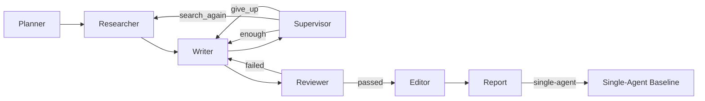

# Dossier Agents

Multi-agent research where every claim is cited and checked.

## What the project does

The app follows a multi-agent pipeline: a Planner breaks a topic into research sections, a Researcher fetches and verifies facts, a Writer drafts each section, a Supervisor gap-fills via search if too few facts are found, a Reviewer checks for unsupported claims, and an Editor assembles the final report with deduplicated sources and per-section pass/fail status. A single-agent baseline runs the pipeline without the Supervisor loop for comparison.

## Architecture



This flow implements the Supervisor gap-filling loop: after each section is researched, the Supervisor decides whether enough facts have been collected. If not, it generates up to 2 new search queries (differing from already-used ones) and re-searches. At most 2 extra rounds per section and 6 total per run are allowed. The Reviewer then checks the draft, and the Editor assembles the report with deduplicated sources and per-section pass/fail status.

## Windows setup

1. Open PowerShell in the project root.
2. Create and activate a virtual environment:

   ```powershell
   py -m venv venv
   .\venv\Scripts\Activate.ps1
   ```

3. Install dependencies:

   ```powershell
   pip install -r requirements.txt
   ```

4. Copy the sample environment file and fill in your keys:

   ```powershell
   Copy-Item .env.example .env
   notepad .env
   ```

5. Add your API credentials:

   - `TAVILY_API_KEY` for web search
   - provider keys depending on the model you want to use (`GEMINI_API_KEY` or `ANTHROPIC_API_KEY`)
   - optionally set `LLM_PROVIDER` to `gemini`, `ollama`, or `anthropic`

6. Run the pipeline:

   ```powershell
   python main.py "What are the main trends in electric scooters in Pakistan?" --pipeline
   ```

## Configuration

The active provider is selected by the `LLM_PROVIDER` value in `.env`:

```env
LLM_PROVIDER=gemini
# or:
# LLM_PROVIDER=ollama
# LLM_PROVIDER=anthropic
```

The project supports the following provider-specific settings in `.env`:

- `gemini`
  - `GEMINI_API_KEY`
  - `GEMINI_MODEL` (optional)
- `ollama`
  - `OLLAMA_MODEL`
  - no API key required if your local Ollama server is already running
- `anthropic`
  - `ANTHROPIC_API_KEY`
  - `ANTHROPIC_MODEL` (optional)

The app validates the configured provider at startup. If a required key is missing or looks like a placeholder, it raises a clear error instead of silently using a broken configuration.

## CLI flags

```powershell
python main.py "Your research question" --pipeline              # full pipeline
python main.py "Your research question" --research              # research-only mode
python main.py "Your research question" --max-sections 3       # limit sections
python main.py "Your research question" --no-supervisor         # skip supervisor loop
python main.py "Your research question" --no-cache              # disable disk cache
python main.py "Your research question" --no-review             # skip reviewer
```

The generated report is saved under `reports/`.

## Web app

The web app uses the FastAPI backend and the Vite frontend. Start each in a separate PowerShell window from the project root.

1. Start the backend with your virtual environment activated:

   ```powershell
   uvicorn app.api:app --reload
   ```

   The API runs at `http://localhost:8000`.

2. In a second window, install and start the frontend:

   ```powershell
   cd frontend
   npm install
   npm run dev
   ```

3. Open the Vite URL printed in the terminal, normally `http://localhost:5173`.

To check or prepare the frontend for production, run these commands from the `frontend/` directory:

```powershell
npm run lint
npm run build
```

## Docker

Build and run the app using the `dossier` image:

```powershell
docker build -t dossier .
docker run --env-file .env -p 8000:8000 dossier
```

## Viewing and exporting reports

In the web report view, sections are shown in this order: passed review, failed review with usable evidence, then no usable evidence. Headings are numbered in display order. Sections without usable sources are labeled **No evidence found**.

- **Copy report as Markdown** copies only sections with usable sources. If none are available, the copy button is disabled. Copied sections are renumbered, and their citations and source list include only sources from those sections.
- The saved Markdown report in `reports/` includes all sections, including those with no usable evidence.
- **Download as PDF** opens the browser's print dialog. Choose the browser's "Save as PDF" destination to save the report as a PDF.

## Running tests

From the project root:

```powershell
pytest
```

The test suite covers the research guardrail and the reviewer logic, including scenarios where facts are missing or drafts include unsupported numbers or invented claims. All new tests use mocked LLM calls.

## Evaluation method

The evaluation compares the single-agent baseline against the full pipeline with the Supervisor gap-filling loop. Each condition (A–D) is scored on yes / partly / no for: enough facts, new queries differ from used ones, loop stops after 2 rounds, and loop respects MAX_EXTRA_SEARCHES. Results are recorded in `eval/scores.md`.

## Results

TODO: paste eval/scores.md here

| Condition | yes | partly | no |
|-----------|-----|--------|----|
| A         |     |        |    |
| B         |     |        |    |
| C         |     |        |    |
| D         |     |        |    |

## Limitations

- The free-tier quota limits the number of LLM calls and web searches per run; the pipeline stops if the daily quota is exhausted.
- The Reviewer checks drafted claims only against the extracted fact pool; claims not in the fact set are flagged as unsupported.
- Source quality varies: official (.gov.pk, .gov, .int, .org.pk), academic (.edu, .ac, sciencedirect.com, etc.), news (a small constant list), aggregator (market research report sites), and company (.com.pk, .com) domains are classified automatically; classification may not match every user's expectations.
- Forecasts and market-size estimates may be out of date; the project does not enforce recency.
- No guarantee is made that any claim in the output is true; all claims should be verified against the cited sources.
- One human scored the evaluation results; inter-rater reliability was not measured.

## Future work

- Add more source-quality heuristics (e.g., domain reputation, publication date).
- Support custom search APIs beyond Tavily.
- Introduce a confidence score per fact.
- Allow the Supervisor budget to be configured per run via CLI.
- Add a fragment mode so only the changed section is re-generated on query updates.

---

Generated by Dossier AI agents; verify sources.